# ShipTrack — Data Model

## 1. Entity Diagram

```mermaid
erDiagram
    CUSTOMER ||--o{ SHIPMENT : sends
    SHIPMENT ||--o{ SHIPMENT_EVENT : has
    SHIPMENT ||--o{ INCIDENT : has
    SHIPMENT ||--o{ DELAY_RECORD : has
    SHIPMENT |o--o| SHIPMENT : "return of"
    SHIPMENT_STATUS ||--o{ SHIPMENT : current
    SHIPMENT_STATUS ||--o{ SHIPMENT_EVENT : recorded
    INCIDENT_TYPE ||--o{ INCIDENT : classifies
    DELAY_REASON ||--o{ DELAY_RECORD : explains
    APP_USER ||--o{ SHIPMENT_EVENT : registers
    APP_USER ||--o{ INCIDENT : registers
    APP_USER ||--o{ DELAY_RECORD : registers

    CUSTOMER {
        int Id PK
        string Name
        string Email
        string Phone
        string Address
    }
    SHIPMENT {
        int Id PK
        string TrackingNumber UK
        int SenderCustomerId FK
        string RecipientName
        string DeliveryAddress
        int CurrentStatusId FK
        date EstimatedDeliveryDate
        int DeliveryAttempts
        string PickupPointName
        int ParentShipmentId FK
        datetime CreatedAt
    }
    SHIPMENT_EVENT {
        int Id PK
        int ShipmentId FK
        int StatusId FK
        datetime OccurredAt
        string Location
        string Notes
        int AttemptNumber
        int UserId FK
    }
    INCIDENT {
        int Id PK
        int ShipmentId FK
        int IncidentTypeId FK
        string Description
        datetime RegisteredAt
        int UserId FK
    }
    DELAY_RECORD {
        int Id PK
        int ShipmentId FK
        int DelayReasonId FK
        string Notes
        datetime RegisteredAt
        int UserId FK
    }
    SHIPMENT_STATUS {
        int Id PK
        string Name
    }
    INCIDENT_TYPE {
        int Id PK
        string Name
    }
    DELAY_REASON {
        int Id PK
        string Name
        bool IsExternal
    }
    APP_USER {
        int Id PK
        string Name
        string Email UK
        string PasswordHash
        string Role
    }
```

## 2. Entities

| Entity | Purpose |
|--------|---------|
| Customer | Sender of the shipment (the party to contact in case of damage, loss or export issues) |
| Shipment | Main entity. Holds the current status and the delivery attempt counter |
| ShipmentEvent | Tracking history. One row per status change |
| Incident | Something that happened to the shipment (incorrect address, damaged, lost...) |
| DelayRecord | Reason why a shipment did not meet its estimated delivery date |
| ShipmentStatus | Lookup table with the statuses defined in the Business Rules |
| IncidentType | Lookup table with the incident types |
| DelayReason | Lookup table with the delay reasons. `IsExternal` marks causes outside the carrier's control |
| AppUser | System users. Role: Operations Staff or Administrator |

## 3. Design Decisions

- **Current status in two places:** `Shipment.CurrentStatusId` makes listing and filtering fast, while `ShipmentEvent` keeps the full history. Both are updated in the same transaction.
- **Returns:** a return is a new `Shipment` with its own tracking number and `ParentShipmentId` pointing to the original.
- **Incidents and delays are separate tables**, following the Business Rules: an incident happens to the shipment; a delay reason explains why the deadline was not met.
- **Lookup tables instead of free text** keep dashboard reports consistent (e.g. incidents by type).
- **Pickup point:** only the store name is stored (`PickupPointName`) in the MVP. A dedicated table is a future improvement.
- **Delivery zones** are not modeled in the MVP. "Irregular Zone" is a delay reason selected manually.
- **Customers** are shipment senders in the MVP. Recipient data is stored in the shipment itself.
